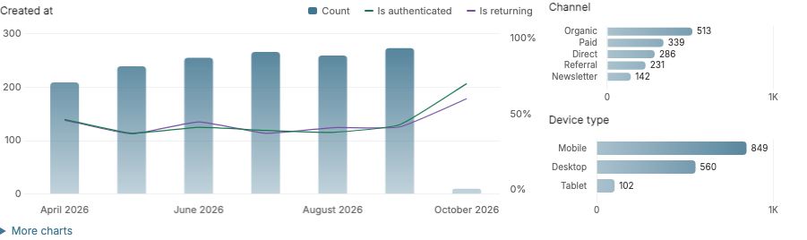
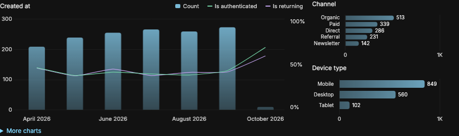

# django-admin-list-charts

Useful charts for Django admin, from one mixin.

<!-- gallery:start -->



<!-- gallery:end -->

```python
@admin.register(Order)
class OrderAdmin(ListChartMixin, admin.ModelAdmin):
    pass
```

Charts appear above the admin list controls and follow search and filters across all results. The timeline takes at least two-thirds of the width, with boolean rates and compact distributions stacked beside it. **More charts** reveals overflow charts and configured metrics. Django’s **Show counts** changes filter counts only. Light, dark and automatic themes work without configuration. Use arrow keys on a focused chart to explore points and Enter to filter.

See the [gallery](docs/gallery.md) for desktop and mobile examples in light and dark mode.

## Quick start

```bash
python -m pip install .
```

For a local checkout, use the command above. The published release can be installed with `python -m pip install django-admin-list-charts==0.5`.

Add `'admin_list_charts'` to `INSTALLED_APPS`, then mix it into an admin:

```python
from django.contrib import admin
from admin_list_charts.admin import ListChartMixin
from .models import Order

@admin.register(Order)
class OrderAdmin(ListChartMixin, admin.ModelAdmin):
    pass
```

Use your project's usual static-file deployment, including `collectstatic`. Chart.js and styles ship in the wheel. Runtime requires Django only; consumers need no Node, CDN, date adapter, migrations, or chart settings.

## What happens automatically

The timeline uses an existing `date_hierarchy`, or prefers `created_at`, `created`, `date_created`, `date_joined`, `published_at`, `published`, then `timestamp`. Otherwise it uses a sole eligible date field. Modification fields and `auto_now` fields are excluded from inference. Ambiguous or absent dates leave distributions available. Inference never changes `date_hierarchy` or adds Django date navigation.

Up to two booleans become timeline rate overlays. Up to three choice/boolean fields become distributions, preferring the request's `get_list_filter(request)`, followed by model choices and booleans. Single-valued related paths such as `company__source` and `company__active` work. Free text, identifiers, unrestricted relations, and multi-valued paths require explicit configuration. Numeric business metrics are always explicit.

Charts appear immediately, independently of Django's “Show counts”. Selection is deterministic. Empty and constant automatic charts are suppressed using their collected results; no replacement-candidate queries run. Default distributions show at most six categories. Long histories coarsen to at most 240 timeline buckets, with missing counts filled with zero and unknown rates/metrics left as gaps. Nullable booleans are excluded from rate denominators.

## Examples

```bash
python -m pip install -e .
python example_project/manage.py migrate
python example_project/manage.py seed_demo --reset --preset small --seed 42 --reference-date 2026-10-01
python example_project/manage.py createsuperuser
python example_project/manage.py runserver
```

Open `/admin/`. Visits, Orders, Accounts, and Jobs each use only the mixin. Separate advanced entries show filters, revenue/average metrics, annotated subscriptions with lazy loading, and related filters with duplicate-producing searches. All data is synthetic. Larger presets are `10000`, `100000`, and `1000000`; reset is explicit.

## Compatibility

| Python | Django |
| --- | --- |
| 3.12, 3.13, 3.14 | 5.2 LTS, 6.0, 6.1 |
| 3.15 | 6.1.3 onward |

SQLite and PostgreSQL are supported. Stock Django admin is the supported theme. [Compatibility details](docs/compatibility.md), [query budgets and performance](docs/performance.md), [optional configuration](docs/advanced.md), and [0.4 → 0.5 migration](docs/migration.md).

## Development

```bash
DJANGO_SETTINGS_MODULE=tests.settings python -m django test tests
npm ci
npm run build
npx playwright install chromium
npm run test:browser
python -m build
python scripts/verify_package.py
```

The Node lockfile is development-only. The build registers only the bar/line components used and keeps Chart.js out of the global namespace. Browser tests pin Chromium, fonts, locale, timezone, seed, and reference date.

Inspired by [Dani Hodovic's original article](https://findwork.dev/blog/adding-charts-to-django-admin/).

Browser baselines share the gallery images and target Chromium on macOS. Firefox and WebKit behavior checks can be run with `PLAYWRIGHT_BROWSER=firefox npm run test:browser` or `PLAYWRIGHT_BROWSER=webkit npm run test:browser` after installing those browsers with Playwright.
