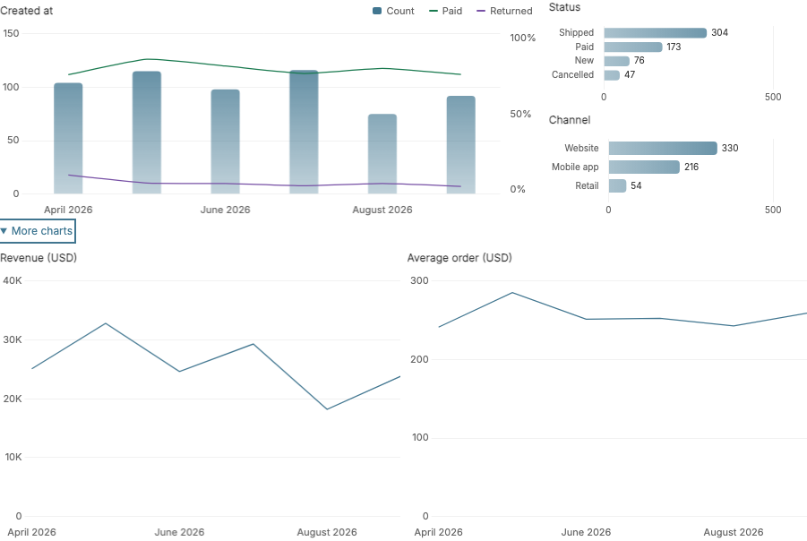
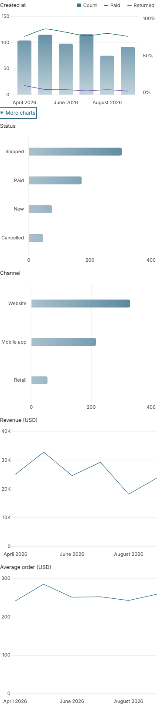
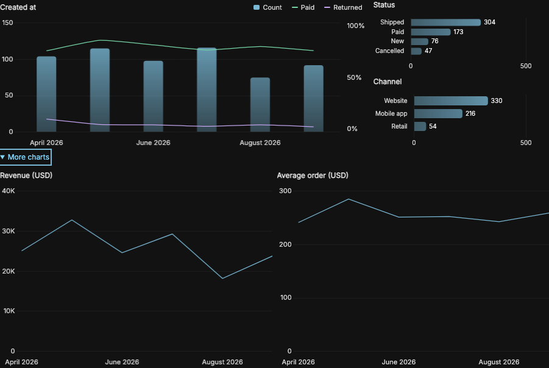
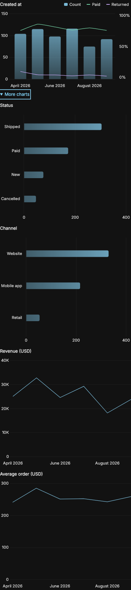

# Gallery

Compact charts adapt to desktop and mobile containers in Django’s light and dark themes.

## Visits

Traffic over time with channel, device and conversion distributions.

## Commerce

Order volume, payment rates and distributions by status and channel.

## Memberships

Account growth, activity rates and membership tiers.

## Publishing

Publishing history, remote-work rates and job status.

## More charts

Open secondary charts and configured metrics when needed.

## Filter counts

Django’s Show counts leaves the chart layout unchanged.

## Long histories

Thin lines retain detail across dense timelines.

Hover or focus a point for exact values and a position guide.

