# Gallery

Timeline-only and counts-enabled charts adapt to desktop and mobile containers in Django’s light and dark themes.

## Visits

Traffic over time with channel, device and conversion distributions.

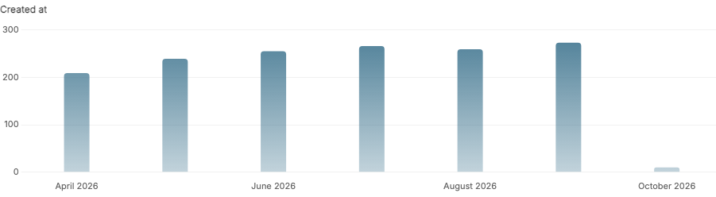

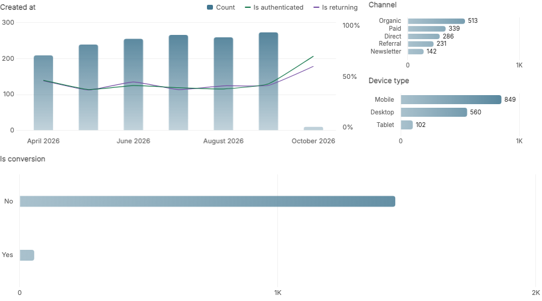

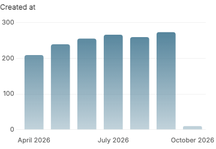

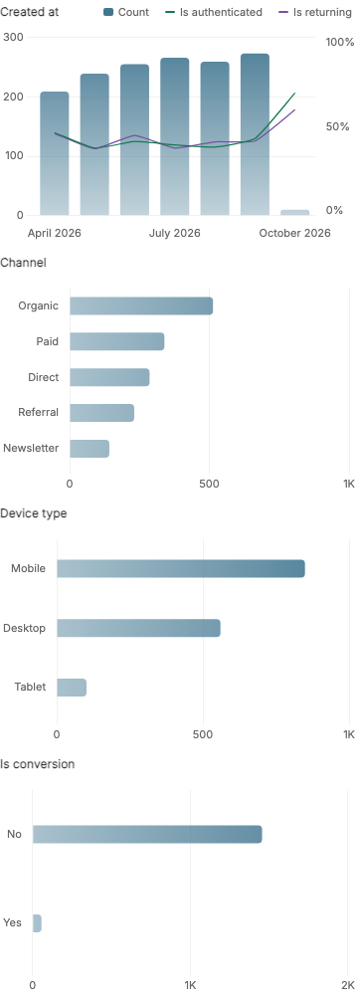

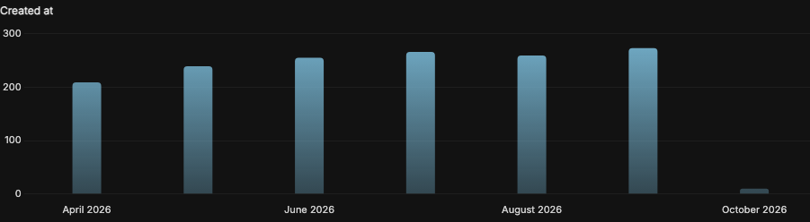

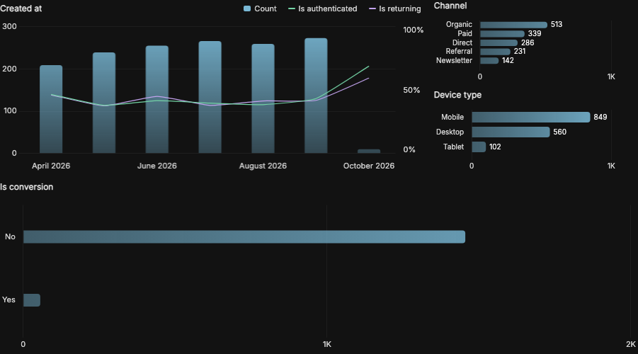

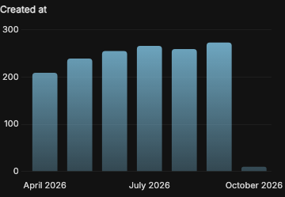

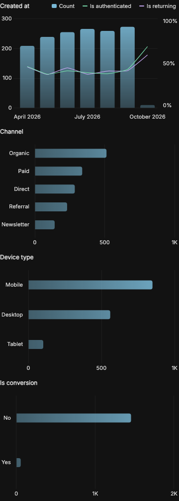

## Commerce

Order volume, payment rates and distributions by status and channel.

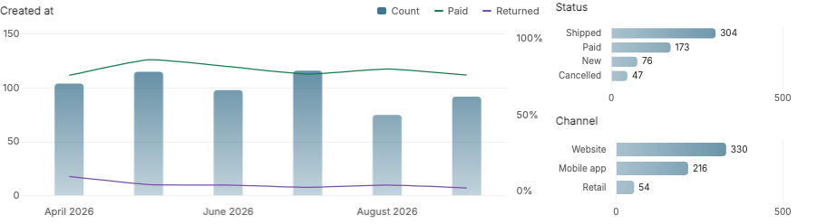

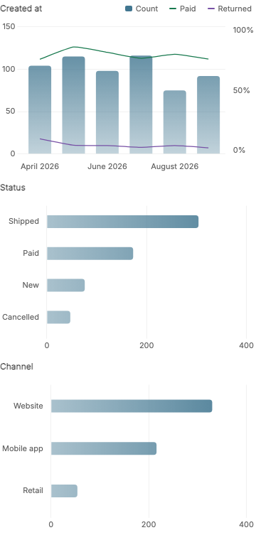

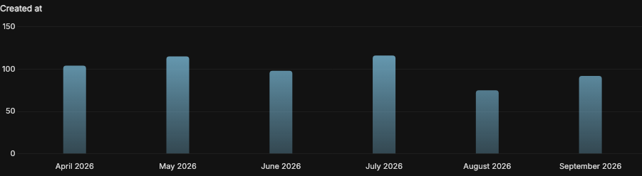

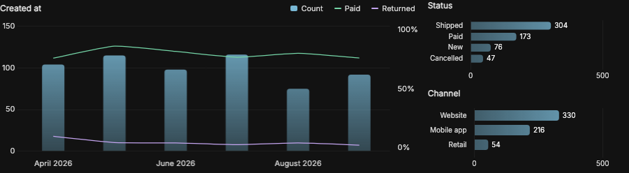

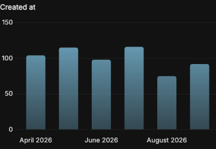

## Memberships

Account growth, activity rates and membership tiers.

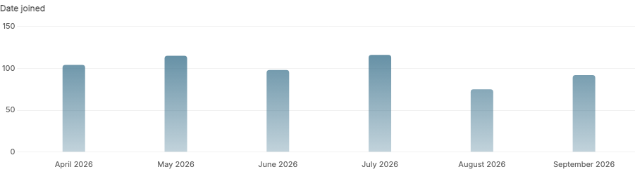

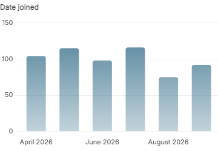

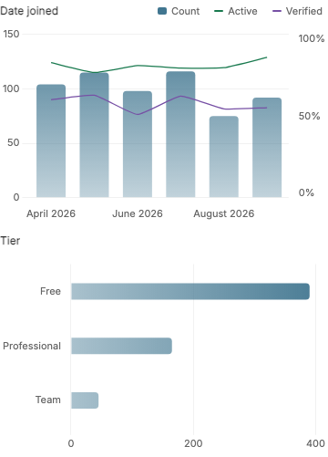

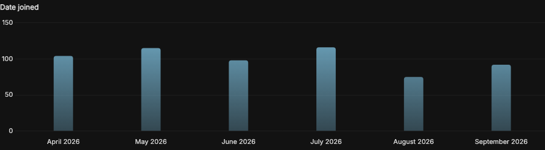

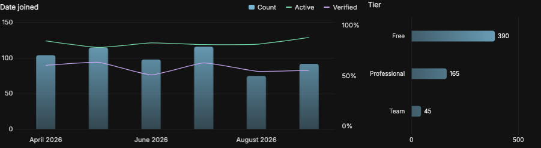

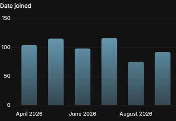

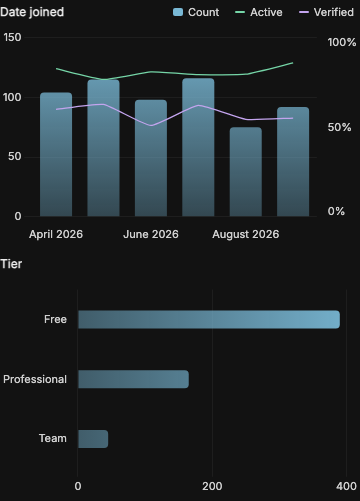

## Publishing

Publishing history, remote-work rates and job status.

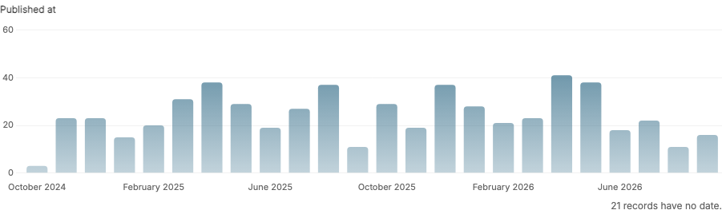

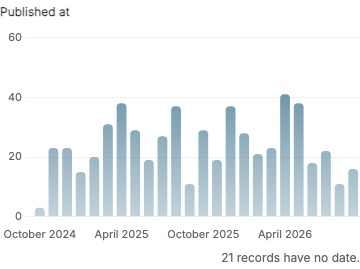

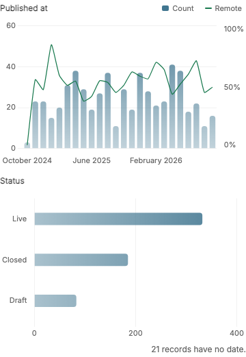

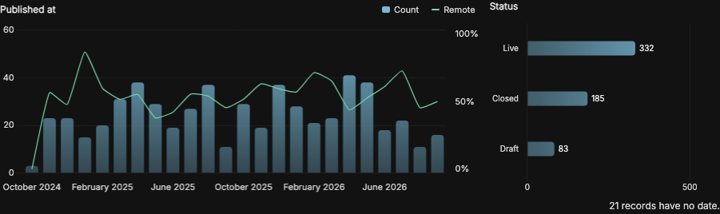

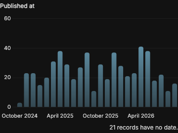

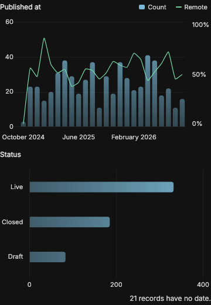

## Long histories

Thin lines retain detail across dense timelines.

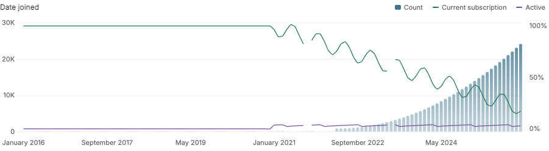

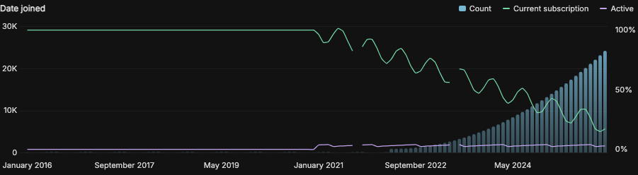

Hover or focus a point for exact values and a position guide.

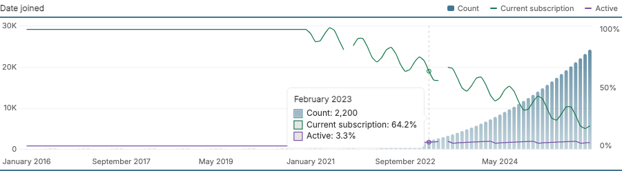

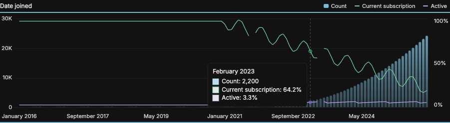
