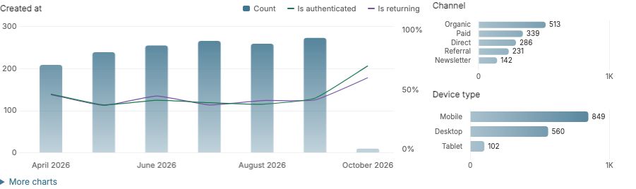
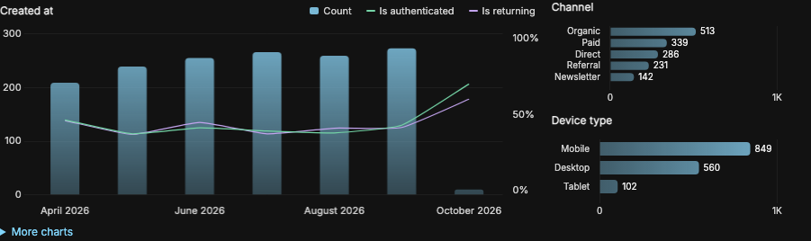

# Useful charts from one mixin

<!-- gallery:start -->



<!-- gallery:end -->

Install from a checkout with `python -m pip install .`, add `'admin_list_charts'` to `INSTALLED_APPS`, and mix it into a stock Django admin:

```python
from django.contrib import admin
from admin_list_charts.admin import ListChartMixin
from .models import Order

@admin.register(Order)
class OrderAdmin(ListChartMixin, admin.ModelAdmin):
    pass
```

Dates, choices and booleans are discovered automatically. Charts follow search and filters across all results. The package includes local assets and supports Django’s light and dark themes.

Charts appear above the list controls. “More charts” reveals secondary charts. “Show counts” changes filter counts only. Use arrow keys to explore a focused chart and Enter to filter.

- [Gallery and runnable examples](gallery.md)
- [Automatic discovery and optional hooks](advanced.md)
- [Python and Django compatibility](compatibility.md)
- [Query budgets and performance](performance.md)
- [Upgrading from 0.4](migration.md)
- [Changelog](changelog.md)
